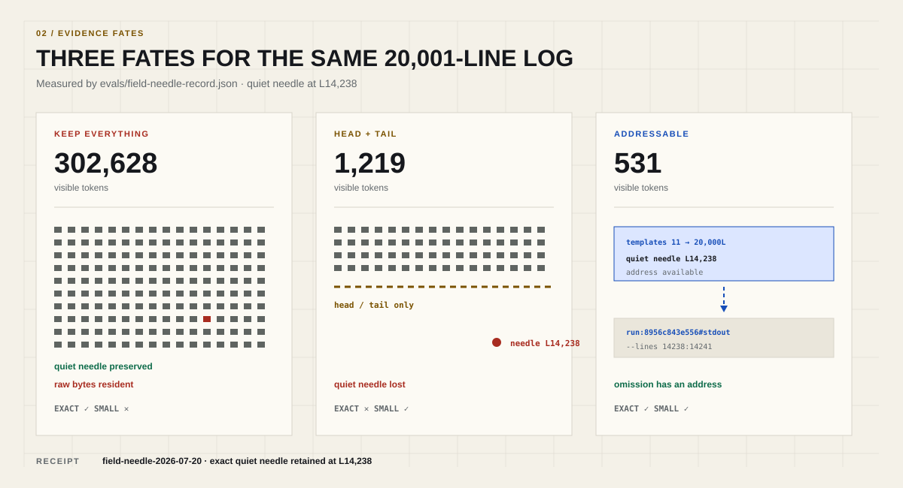
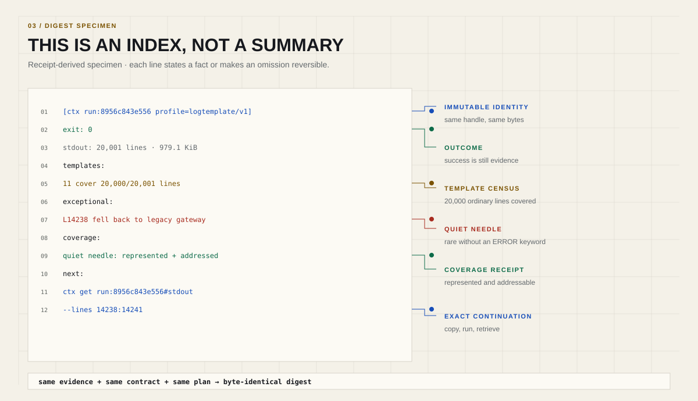
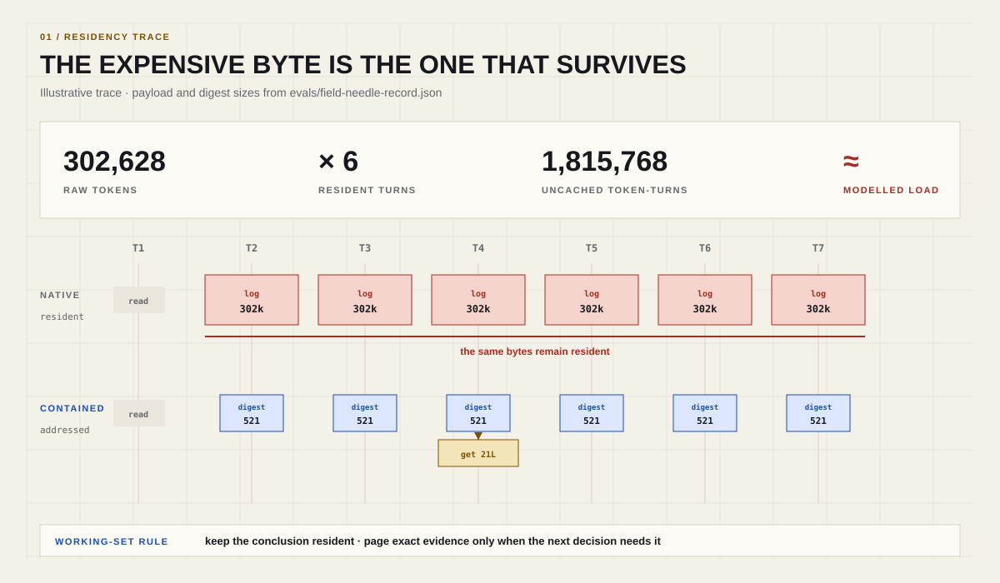

# How Straitjacket manages context

[Documentation](README.md) · [Getting started](GETTING-STARTED.md) · [Core concepts](CONCEPTS.md)

A failing test can print thousands of lines before the agent makes its first edit.
Run the test through `ctx`. The harness receives the failing test names, source
locations and a handle. It can fetch a traceback later. The log stays on disk,
and subsequent model requests carry only the evidence the agent has read.

<picture>
  <source media="(max-width: 640px) and (prefers-color-scheme: dark)" srcset="https://raw.githubusercontent.com/vamsiramakrishnan/straitjacket/main/assets/readme/diagrams/ae-evidence-fates-mobile.svg">
  <source media="(max-width: 640px)" srcset="https://raw.githubusercontent.com/vamsiramakrishnan/straitjacket/main/assets/readme/diagrams/ae-evidence-fates-mobile-light.svg">
  <source media="(prefers-color-scheme: dark)" srcset="https://raw.githubusercontent.com/vamsiramakrishnan/straitjacket/main/assets/readme/diagrams/ae-evidence-fates.svg">
  
</picture>

## Capture output once

```bash
ctx run -- pytest -q
```

Straitjacket runs the command with the caller's permissions and captures stdout
and stderr locally. For large pytest output, the pytest profile identifies
failures and traceback spans. Other profiles extract facts specific to their
formats. Small outputs can fit in full. By default the digest is computed locally.

The output budget and the storage limit serve different purposes. A digest can
omit thousands of lines that the agent can still retrieve. If a stream exceeds
the storage limit (64 MiB per stream by default), capture keeps the head and
tail and reports the dropped middle. Retrieval can return only retained bytes,
subject to the current redaction policy. [Storage settings](CONFIGURATION.md)

<picture>
  <source media="(max-width: 640px) and (prefers-color-scheme: dark)" srcset="https://raw.githubusercontent.com/vamsiramakrishnan/straitjacket/main/assets/readme/diagrams/ae-digest-anatomy-mobile.svg">
  <source media="(max-width: 640px)" srcset="https://raw.githubusercontent.com/vamsiramakrishnan/straitjacket/main/assets/readme/diagrams/ae-digest-anatomy-mobile-light.svg">
  <source media="(prefers-color-scheme: dark)" srcset="https://raw.githubusercontent.com/vamsiramakrishnan/straitjacket/main/assets/readme/diagrams/ae-digest-anatomy.svg">
  
</picture>

## Retrieve the evidence for the next decision

Use the handle printed by your run in place of the example ID. Search for the
exception, then request the matching lines and their surroundings.

```bash
ctx search run:8d8335db6848#stdout "MissingTenantError"
ctx get run:8d8335db6848#stdout --lines 1280:1300
```

A large read returns a bounded view with a continuation. After rerunning a
command, use `ctx diff run:A run:B` with the two run IDs to compare results.
For a live source file, an anchored address checks that the cited text still
exists and relocates it when possible. [Source anchors](ANCHORS.md)

<picture>
  <source media="(max-width: 640px) and (prefers-color-scheme: dark)" srcset="https://raw.githubusercontent.com/vamsiramakrishnan/straitjacket/main/assets/readme/diagrams/ae-residency-mobile.svg">
  <source media="(max-width: 640px)" srcset="https://raw.githubusercontent.com/vamsiramakrishnan/straitjacket/main/assets/readme/diagrams/ae-residency-mobile-light.svg">
  <source media="(prefers-color-scheme: dark)" srcset="https://raw.githubusercontent.com/vamsiramakrishnan/straitjacket/main/assets/readme/diagrams/ae-residency.svg">
  
</picture>

## Preserve the prompt prefix

A prompt cache can reuse the beginning of a request that matches an earlier
request. Moving a changing detail to the front breaks that match from that
point onward. Shortening a **new** tool result before it enters the transcript
leaves the earlier messages alone. The result and each follow-up read go at the
end. Replaying the same capture with the same profile, policy and focus
produces the same digest in the default local mode.

| Who builds the request? | How to preserve the prefix |
|---|---|
| Your existing coding harness | Use `ctx run` for large results and append the bounded reads that follow. The harness controls the system message, tool definitions and conversation history. |
| Your own application | Put stable reference text first with `ctx compress --cache-prefix`. Append the selected evidence and current question. Keep the surrounding instructions and tool definitions stable too. [Runnable example](QUERY-AWARE-SELECTION.md#build-a-reusable-prompt-prefix) |
| Claude Code with the observer proxy | `ctx wrap claude --proxy` can record request shape and usage. The default observer forwards request bodies unchanged. Use `ctx stats --session` in that workspace to inspect the first prefix, cache reads, writes and detected invalidations. [Host prefix audit](HOST-CAPABILITIES.md) |

Prefix stability makes reuse possible. The provider decides whether a request
hits its cache. The optional Claude proxy rescue mode deliberately changes old
tool results at a threshold. It saves their contents locally, inserts
retrieval references and freezes the replacements until the next threshold
crossing. The first request after a rewrite can incur a cache miss.
[Rescue behavior](LOSSLESS-RESCUE.md)

## Measure the whole task

Compare native and wrapped runs on the same fixture, resolved model, host
version, budget and acceptance tests. Record task success, uncached input,
cache reads, cache writes, output, retrieval calls, wall time and total cost.
Include retries. A byte count describes what reached the prompt. The bill also
depends on what the agent does next.

In the checked-in three-task canary, both arms solved all three tasks in one
run per task. Median cache hit rate rose from 96.5% to 97.5% with the wrapper,
yet total cost rose from $0.6676 to $0.9206. A larger prompt can achieve a
higher hit rate and still cost more. [Benchmark results](../evals/agentbench/RESULTS.md)

## Connect the harness

For selective capture, any terminal-capable host can call `ctx run`.
For automatic capture, `ctx setup` installs the hooks the host supports.
Claude Code and Codex can bound results after execution. In the documented
Antigravity CLI integration, a pre-tool hook can rewrite supported commands
before execution, while the post-tool hook cannot replace a connector result.
The host still decides whether to permit the underlying operation.
[Supported hooks and live validation](HOST-CAPABILITIES.md)
